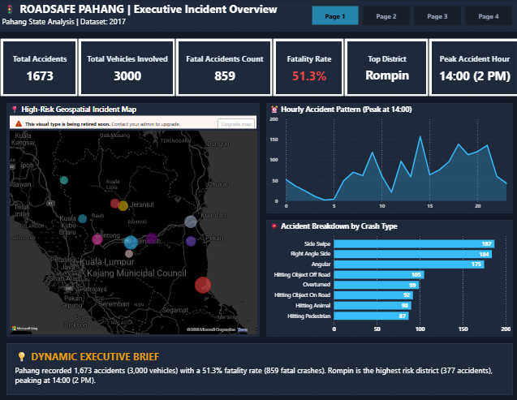
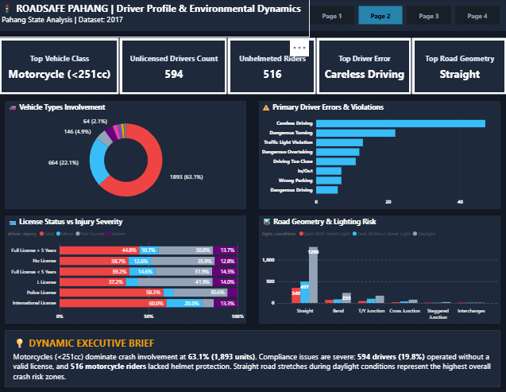
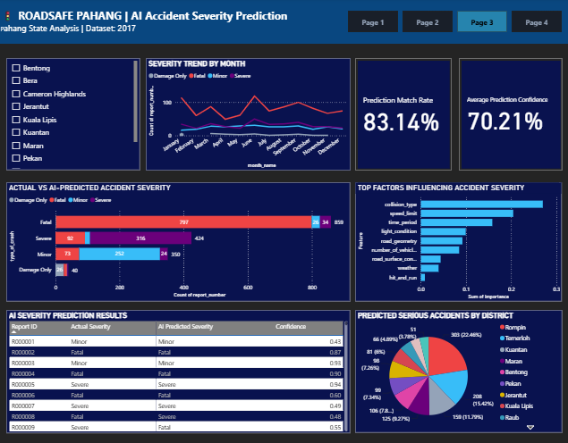
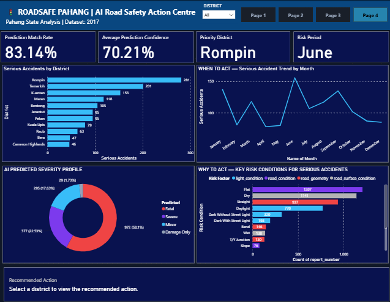

# Road-Safe-Pahang-
An interactive Power BI dashboard analyzing 2017 road accident data across Pahang, Malaysia to identify high-risk districts, peak incident hours, and accident severity factors.
# 🚦 ROADSAFE PAHANG | Traffic Analytics & AI Severity Prediction

An interactive 4-page Power BI dashboard analyzing 2017 road accident data across Pahang, Malaysia. It covers crash hotspots, driver behavior, AI severity predictions, and district-level road safety actions.

🔗 **[View Live Interactive Dashboard](https://powerbi.com)**

## 📊 Key Highlights
* **Page 1 – Executive Overview:** Analyzed **1,673 accidents** (3,000 vehicles) with a **51.3% fatality rate**. **Rompin** is the highest-risk district, and crashes peak at **2:00 PM**.
* **Page 2 – Driver & Road Factors:** **Motorcycles (<251cc)** make up **63.1%** of vehicles involved. Uncovered **594 unlicensed drivers** and **516 unhelmeted riders**, with **Careless Driving** as the top error.
* **Page 3 – AI Severity Prediction:** Integrated ML predictions achieving an **83.14% match rate**, identifying **collision type** and **speed limit** as the top severity factors.
* **Page 4 – Road Safety Action Centre:** Built an interactive tool highlighting **Rompin** and the month of **June** as top priorities, with dynamic safety recommendations per district.

## 🛠️ Tools Used
* **Power BI & DAX:** Custom KPIs, dynamic text summaries, geospatial maps, and multi-page navigation.
* **Data Modeling & ML:** Connected cleaned accident/vehicle datasets with AI severity predictions and feature importance data.

## 🖼️ Dashboard Screenshots
### Page 1: Executive Overview

### Page 2: Driver & Environmental Dynamics

### Page 3: AI Severity Prediction

### Page 4: Road Safety Action Centre

